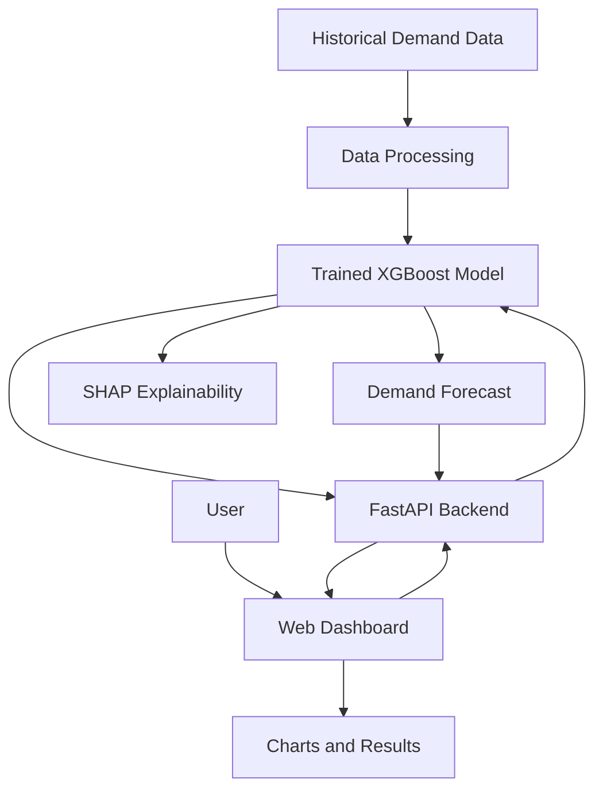

# Supply Chain Demand Forecasting Web Application

An ML-powered web application that forecasts future product demand using historical supply chain data. The project combines machine learning, an interactive dashboard, and model explainability to help users understand demand trends and make more informed inventory planning decisions.

## Table of Contents

- [Overview](#-overview)
- [Problem Statement](#-problem-statement)
- [Key Features](#-key-features)
- [Technology Stack](#-technology-stack)
- [System Architecture](#-system-architecture)
- [Project Structure](#-project-structure)
- [Getting Started](#-getting-started)
- [Model and Evaluation](#-model-and-evaluation)
- [Demo](#-demo)
- [Challenges and Learnings](#-challenges-and-learnings)
- [Future Improvements](#-future-improvements)

## Overview

Supply Chain Demand Forecasting is a machine learning web application designed to analyze historical demand data and generate forecasts that support inventory and supply chain planning.

The application uses an **XGBoost forecasting model** and a **FastAPI backend** to provide predictions through a web-based dashboard. Interactive visualizations help users explore demand patterns, while SHAP explainability provides insight into the features influencing model predictions.

The project demonstrates how machine learning models can be integrated into a web application to support practical business decision-making.

## Problem Statement

Uncertain product demand makes inventory planning difficult. Businesses may experience stock shortages when demand is underestimated or excess inventory when demand is overestimated.

Analyzing historical demand and generating forecasts can help businesses make better-informed decisions about inventory levels and future resource requirements.

## Key Features

- **Demand Forecasting:** Uses a trained XGBoost model to generate demand predictions.
- **Interactive Dashboard:** Displays forecasting information through a browser-based interface.
- **Demand Visualization:** Uses Chart.js for interactive charts.
- **Model Explainability:** Uses SHAP to help explain the factors influencing model predictions.
- **Historical Data Processing:** Includes datasets and scripts for preparing and generating demand data.
- **Saved Model Artifacts:** Stores the trained model and supporting evaluation and metadata files.
- **Web API:** Uses FastAPI to connect the forecasting functionality with the frontend.

## Technology Stack

| Component | Technologies |
|---|---|
| Programming Language | Python, JavaScript |
| Machine Learning | XGBoost |
| Data Processing | Pandas, NumPy |
| Model Explainability | SHAP |
| Backend | FastAPI |
| Frontend | HTML5, CSS3, JavaScript |
| Visualization | Chart.js |
| Model Storage | Joblib |
| Development Tools | VS Code, Git, GitHub |

## System Architecture

The application follows a web-based machine learning architecture.



### Workflow

1. Historical demand data is stored in the project's data directory.
2. Data preparation and training scripts support the forecasting workflow.
3. The trained model is saved as a model artifact.
4. FastAPI provides the backend interface for the web application.
5. The frontend communicates with the backend to display forecasting results.
6. Chart.js visualizes the available demand and forecasting information.
7. SHAP helps explain the influence of relevant features on predictions.

## Project Structure

```text
Project_Supply_Chain_Forecasting/
│
├── backend/
│   └── app.py
│
├── data/
│   ├── demand_data.csv
│   ├── demand_data_real.csv
│   ├── download_real_data.py
│   └── generate_data.py
│
├── frontend/
│   ├── index.html
│   ├── style.css
│   ├── script.js
│   └── chart.min.js
│
├── model/
│   ├── train.py
│   └── artifacts/
│       ├── model.joblib
│       ├── metrics.json
│       ├── history_tail.csv
│       └── sku_categories.csv
│
├── requirements.txt
├── README.md
├── .gitignore
└── Supply_Chain_Forecast_web.mp4
```

### Important Files

- `backend/app.py` — FastAPI application and backend functionality.
- `frontend/index.html` — Dashboard structure.
- `frontend/style.css` — Dashboard styling and layout.
- `frontend/script.js` — Frontend interactions and API communication.
- `frontend/chart.min.js` — Chart.js library used for visualization.
- `data/` — Demand datasets and data preparation scripts.
- `model/train.py` — Model training workflow.
- `model/artifacts/model.joblib` — Saved forecasting model.
- `model/artifacts/metrics.json` — Stored model evaluation information.
- `requirements.txt` — Python dependency list.

## Getting Started

Follow these steps to run the project locally.

### Prerequisites

- Python installed on your system.
- Git installed on your system.
- Visual Studio Code or another code editor.
- A terminal for executing commands.

### 1. Clone the Repository

```bash
git clone https://github.com/Priyadharshini-sk06/Supply_Chain_Forecasting_Web_project-III.git
cd Supply_Chain_Forecasting_Web_project-III
```

### 2. Create a Virtual Environment

**Windows PowerShell:**

```powershell
python -m venv .venv
.\.venv\Scripts\Activate.ps1
```

If PowerShell blocks activation, use Command Prompt instead:

```bat
.venv\Scripts\activate.bat
```

### 3. Install Dependencies

```bash
python -m pip install -r requirements.txt
```

### 4. Start the Backend

From the project root, run:

```bash
python -m uvicorn backend.app:app --reload
```

If the application uses a different import configuration, use the entry point specified by the project's backend setup.

### 5. Open the Application

Open the local URL configured by the FastAPI application in your browser. With the standard Uvicorn configuration above, the backend is available at:

`http://127.0.0.1:8000`

FastAPI's interactive API documentation is commonly available at:

`http://127.0.0.1:8000/docs`

The dashboard and API endpoints depend on the routes configured in `backend/app.py`.

## Model and Evaluation

The project uses XGBoost for demand forecasting and includes saved artifacts to support model evaluation and application execution.

The repository contains:

- A trained model stored in `model/artifacts/model.joblib`.
- Evaluation information stored in `model/artifacts/metrics.json`.
- Historical records in `model/artifacts/history_tail.csv`.
- Product category information in `model/artifacts/sku_categories.csv`.

Model performance should be reported using the actual evaluation results generated by the training workflow.

Useful forecasting evaluation metrics include:

- **MAE (Mean Absolute Error):** Measures the average absolute difference between actual and predicted demand.
- **RMSE (Root Mean Squared Error):** Penalizes larger prediction errors more strongly.

Only include these metrics as reported results if the training workflow actually calculates them. Add the verified values from `metrics.json` before publishing performance claims.

## Demo

Watch the project demonstration:

[▶️ Supply Chain Forecasting Web Application Demo](./Supply_Chain_Forecast_web.mp4)

The video is included in the repository and demonstrates the application workflow.

## Challenges and Learnings

This project provides practical experience with:

- Integrating a machine learning model into a web application.
- Building API-based communication between a frontend and backend.
- Processing historical data for forecasting.
- Presenting prediction results using interactive charts.
- Understanding model explainability with SHAP.
- Organizing a project into separate frontend, backend, data, and model components.
- Managing dependencies and source code using Git and GitHub.

### Design Decisions

- **FastAPI:** Provides a Python-based API layer for the forecasting application.
- **XGBoost:** Serves as the demand prediction model.
- **Chart.js:** Supports interactive visual presentation of forecasting results.
- **SHAP:** Helps interpret model predictions and feature contributions.
- **Separate Project Directories:** Keep application code, datasets, and model artifacts organized.

## Future Improvements

Potential extensions include:

- Adding forecast horizon selection.
- Supporting user-uploaded demand datasets.
- Comparing multiple forecasting models.
- Providing downloadable forecasting reports.
- Adding inventory threshold alerts.
- Deploying the application to a cloud platform.
- Improving input validation, testing, and production monitoring.

These are proposed improvements and are not necessarily implemented in the current version.

## Author

**Priyadharshini S K**

B.Tech — Information Technology

[GitHub Profile](https://github.com/Priyadharshini-sk06)

## License

No license has been specified for this project yet. Add an appropriate license file if you intend to distribute the project for reuse.
